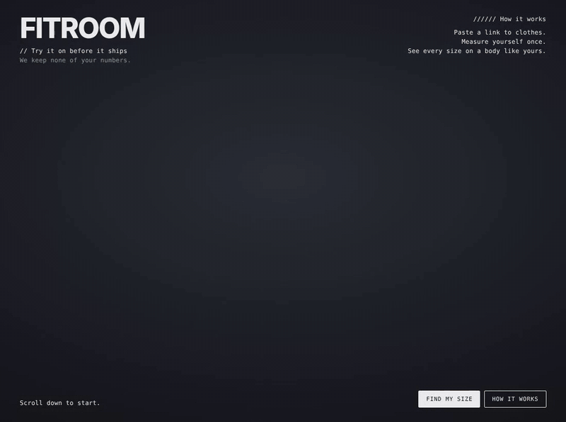

# Fitroom

See how clothes fit before you buy them. Paste a link to a shirt, a dress or a pair of pants, enter a few of
your own measurements, and Fitroom sews the garment from its size chart and drapes it on a 3D mannequin shaped
like you, in every size, with the shop's colour and print. It tells you which size fits best, part by part,
and what a tailor could or couldn't change.

[](docs/images/demo.gif)

*A Kith tee from its link, on the example body (waiting sped up).*

## Quick start

You need Ruby 3.4.3. Node 22 is only for the JavaScript tests.

```bash
bundle install
bin/rails db:prepare
bin/dev                                   # http://localhost:3000
bin/rails test                            # fit math, link importer, the API and the page
node --test test/javascript/*.test.mjs    # pattern drafting, photo reading, body solver
```

Optional settings are environment variables, listed in `.env.example`; copy it to `.env` and `bin/dev` loads it. Fitroom runs without any of them.

## How to use it

1. **Add clothes.** Paste a product link and press **Add**. Most Shopify shops work, Kith included, and so do
   pages with a size chart. No link? Paste a size chart, type in sizes, or just add a photo, and Fitroom
   works out what it is.
2. **Measure yourself.** Pick **Man** or **Woman**, then move the sliders or type your chest, waist,
   shoulders, arm and height. Hips and inseam are for pants and dresses. **Use example numbers** fills in a
   typical body to try it out.
3. **See it on.** The garment is sewn and settles on the mannequin in a few seconds. Drag to turn it, and
   try the poses: standing, relaxed, walking and arms out.
4. **Pick a size.** The best size is marked with a star. Tap any other size to see it drape. Each part
   (shoulders, chest, waist, sleeves, length) says if it fits, and what a tailor could fix.
5. **Check the fit.** **Fit colors** paints the cloth by how each part fits. **Clothes only** hides the
   mannequin.

## Features

- **Clothes from a link:** reads the shop's product details and its size chart, in inches or cm, garment
  or body measurements. With no chart, it uses the usual measurements for each size, and the shop photo
  says how the piece is cut (a baby tee, or a boxy tee with dropped shoulders).
- **Sewn, not stretched:** tops, shirts, hoodies, zip-ups, bombers, dresses, pants, shorts, joggers,
  leggings and skirts get a real sewing pattern for each size, and a cloth simulation drapes them in the
  browser.
- **Dresses as they're cut:** strapless, one shoulder, thin or wide straps, sleeves; mini to maxi; fitted
  to flared; stretch, jersey, silk, leather or cotton. All read from the listing.
- **The shop's look:** the cloth takes the colour and front print from the store photo.
- **Men's and women's sizes:** letter sizes, US dress sizes, suit sizes, waist sizes and brand numbers
  like "M (2)".
- **Honest fit:** big-on-purpose clothes are judged as they're meant to be worn, and stretch clothes as
  made smaller than the body.
- **Private:** no accounts. Your measurements are used for one answer and never stored or logged, and
  photos are read in your browser.
- **Real clothes (optional):** with the try-on service set up, **Real clothes (AI)** paints the store's own
  photo of each piece onto the mannequin, in about a minute. Our checks make sure it still fits the same
  way; if not, you get our own picture. Only the mannequin's picture and the store photos are sent, and
  nothing is kept. The button only shows when the server has the service (see `.env.example`).
- **Clear about the rest:** shoes, socks, belts and hats get a plain "not yet".

## How it's built

Ruby on Rails 8 runs the fit math, the link importer and a JSON API (`/api/v1`). Hotwire Stimulus and
Three.js r170 run the page: the mannequin, the pattern drafting, the cloth simulation and the fabrics. The
mannequin is built in Blender from MakeHuman's CC0 assets. The details are in
[docs/how-it-works.md](docs/how-it-works.md) and the API in [docs/api.md](docs/api.md).

Plans are in [ROADMAP.md](ROADMAP.md). License: MIT, see [LICENSE](LICENSE). The 3D model's assets are
CC0, see [public/models/CREDITS.md](public/models/CREDITS.md).
